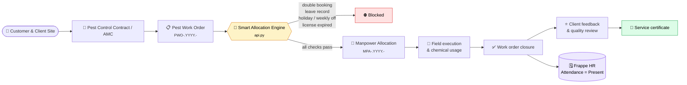

<div align="center">


<br><br>


**[Features](#-features)** · **[How it works](#-how-it-works)** · **[DocTypes](#-doctypes)** · **[Reports](#-workspace--reports)** · **[API](#-rest-api)** · **[Install](#-installation)** · **[Contributing](#-contributing)**

</div>

<br>

## 📖 Overview

A custom **Frappe app** for pest control, manpower allocation and facility management companies. It covers the full operational lifecycle:

> **Multi-site contracts** → **Work orders** → **Validated technician dispatch** → **Field execution & chemical usage** → **Client sign-off, certificate & HR attendance**

It plugs straight into **ERPNext** (customers, items, billing) and **Frappe HR** (employees, leave, holidays, shifts, attendance), so there is **no duplicate master data** and **no spreadsheet-based rostering**.

<br>

## 🎯 Why use it?

| 🚧 Problem in the field | ✅ How this app handles it |
|---|---|
| Technician double-booked on the same shift | Allocation is **rejected** if a conflicting booking exists |
| Technician on approved leave gets dispatched | Checked against Frappe HR **Leave Applications** |
| Assignments on weekly offs or public holidays | Checked against the **Holiday List**, with an emergency-overtime override flag |
| Unlicensed staff handling pesticides | **Pesticide Handling License** validity verified at allocation time |
| Attendance entered twice (ops and HR) | Attendance is **auto-marked Present** when the work order completes |
| Clients asking for proof of service | Print-ready **Pest Service Certificate** |

<br>

## ✨ Features

<table>
<tr>
<td width="50%" valign="top">

### 📋 Work order management
Draft → Scheduled → In Progress → Completed, with shift slots, priorities and client ratings.

### 🧠 Smart manpower allocation
Double-booking, leave, holiday and license checks in one engine.

### 🏢 Multi-site facilities
Several premises per customer, with site type, area (sq ft) and risk rating.

### 📑 AMC & contracts
AMC, one-time and seasonal contracts, with Monthly, Quarterly or Upfront billing and renewal tracking.

</td>
<td width="50%" valign="top">

### 🧪 Chemical & consumable tracking
Active ingredient, batch number, dosage and quantity used per visit.

### 🔄 HR attendance sync
Completing a work order registers attendance in Frappe HR.

### 📊 Operations workspace
Number cards, shortcuts and **9 analytical reports**.

### 🏅 Service certificate
A digital completion and compliance certificate for client handover.

### 🔌 REST API
Whitelisted methods for mobile apps, client portals and external dispatch tools.

</td>
</tr>
</table>

<br>

## 🔄 How it works



<br>

## 🗂 DocTypes

### 🛠 Operations

| DocType | Naming | Purpose |
|---|---|---|
| **Pest Work Order** | `PWO-.YYYY.-` | A scheduled field visit. Links to Customer, Site, Contract and Service Type. Holds the technician table (*Pest Work Order Technician*), the chemicals table (*Pest Chemical Consumable*), client rating, technician observations and supervisor quality notes. |
| **Manpower Allocation** | `MPA-.YYYY.-` | Submittable document that assigns a technician to a job, with shift slot, role and check-in/check-out timestamps. On submit it links back to the work order and feeds HR attendance. |

<table>
<tr>
<td width="50%" valign="top">

**🕐 Shift slots**

| Slot | Hours |
|---|---|
| 🌅 Morning | 08:00 – 12:00 |
| ☀️ Afternoon | 13:00 – 17:00 |
| 🌙 Evening / Night | 18:00 – 22:00 |

</td>
<td width="50%" valign="top">

**👥 Roles**

- 🥇 Lead Technician
- 🤝 Assistant Technician
- 💨 Chemical Sprayer
- 🔍 Quality Inspector

</td>
</tr>
</table>

### 🏗 Facilities & contracts

| DocType | Details |
|---|---|
| **Pest Control Site** | Multiple sites per client. **Types:** Commercial Office, Residential Villa / Flat, Food & Beverage / Restaurant, Healthcare / Hospital, Industrial / Warehouse, Shopping Mall. **Risk levels:** 🟢 Low · 🟡 Medium · 🟠 High · 🔴 Critical – Food Safety |
| **Pest Control Contract** | **Types:** Annual Maintenance Contract (AMC), One-Time Service Contract, Seasonal Disinfestation. Tracks contract value, payment schedule and service frequency. |
| **Service Type** | Treatment catalog, e.g. Termite Control, Bedbug Eradication, Rodent Baiting, General Disinfection, Mosquito Fogging. |

### 🔗 Frappe HR & ERPNext touchpoints

| Standard DocType | Used for |
|---|---|
| `Employee` | Technician contact, certification and license status |
| `Leave Application` | Blocks scheduling during approved leave |
| `Holiday List` | Warns or blocks on weekly offs and public holidays |
| `Shift Assignment` | Correlates shift hours with dispatch slots |
| `Attendance` | Auto-marked Present on work order completion |
| `Customer` | Contacts and billing addresses |
| `Item` | Chemicals and PPE for inventory tracking |

<br>

## 📊 Workspace & Reports

The **Pest Control & FM** workspace includes four number cards:

| 🗓 Scheduled Jobs | ✅ Completed Jobs | 📑 Active AMC Contracts | 🎓 Certified Technicians |
|:---:|:---:|:---:|:---:|

<details>
<summary><b>📈 View all 9 reports</b></summary>

<br>

| Report | Use it for |
|---|---|
| **Today's Dispatch Report** | Morning standup sheet for supervisors |
| **Daily Manpower Deployment** | Technician matrix by shift and role |
| **Scheduled & Unallocated Work Orders** | Jobs that still lack manpower |
| **Work Orders in Progress** | Live on-site jobs |
| **Completed Visits by Date** | Historical audit of completed visits |
| **Overdue AMC Visits** | Contracts overdue for periodic service |
| **AMC Contract Expiry & Renewal** | Forward-looking renewal pipeline |
| **Failed Services & Revisit Queue** | Unresolved complaints and rework |
| **Technician Planned Deployment vs Recorded Attendance** | Variance between dispatched shifts and HR check-ins |

</details>

<br>

## 🔌 REST API

All methods are whitelisted in `pest_control/api.py` and callable from the desk (`frappe.call`) or over HTTP at `/api/method/<dotted.path>`.

<details open>
<summary><b>🔎 <code>get_available_technicians</code></b></summary>

<br>

Returns eligible technicians for a date and slot. Technicians on approved leave or already booked are excluded, and the rest are scored by completed jobs.

```js
frappe.call({
  method: "pest_control.api.get_available_technicians",
  args: { date: "2026-10-26", time_slot: "Morning (08:00 - 12:00)" },
});
```

</details>

<details>
<summary><b>👷 <code>assign_technicians</code></b></summary>

<br>

Bulk-creates and submits **Manpower Allocation** records for a work order.

```js
frappe.call({
  method: "pest_control.api.assign_technicians",
  args: {
    work_order: "PWO-2026-00001",
    assignments: [
      { employee: "EMP-0001", role: "Lead Technician" },
      { employee: "EMP-0002", role: "Chemical Sprayer" },
    ],
  },
});
```

</details>

<details>
<summary><b>✅ <code>complete_work_order</code></b></summary>

<br>

Completes the work order, sets technician check-out timestamps and registers HR attendance.

```js
frappe.call({
  method: "pest_control.api.complete_work_order",
  args: {
    work_order: "PWO-2026-00001",
    client_feedback: "Excellent",
    remarks: "Cockroach gel baiting applied across kitchen and pantry.",
  },
});
```

</details>

<details>
<summary><b>🌐 Calling over HTTP (token auth)</b></summary>

<br>

```bash
curl -X POST https://<your-site>/api/method/pest_control.api.get_available_technicians \
  -H "Authorization: token <api_key>:<api_secret>" \
  -H "Content-Type: application/json" \
  -d '{"date": "2026-10-26", "time_slot": "Morning (08:00 - 12:00)"}'
```

</details>

<br>

## 🚀 Installation

**Prerequisites**

- Bench CLI
- Python 3.10+
- Frappe Framework v15, ERPNext v15 and Frappe HR v15 installed on the target site

```bash
# 1. Go to your bench
cd ~/frappe-bench

# 2. Fetch the app
bench get-app https://github.com/Gopika-Dileep/frappe-custom-app.git

# 3. Install it on your site
bench --site <your-site-name> install-app pest_control

# 4. Migrate and clear cache
bench --site <your-site-name> migrate
bench --site <your-site-name> clear-cache
```

> [!IMPORTANT]
> ERPNext and Frappe HR must already be installed on the site before running `install-app`.

**Optional smoke test**

```bash
bench --site <your-site-name> execute pest_control.test_engine.run_test
```

### ✅ First-time setup checklist

- [ ] Create **Service Types** for the treatments you offer
- [ ] Add **Chemical / PPE Items** in Stock
- [ ] Make sure technician **Employees** have license details filled in
- [ ] Maintain a **Holiday List** and assign it to the company or employees
- [ ] Create a **Pest Control Site** for each customer premises, then a **Contract**

<br>

## 🛠 Development

```bash
cd apps/pest_control
pre-commit install
```

| Tool | Purpose |
|---|---|
| **Ruff** | Python linting and formatting |
| **ESLint + Prettier** | JavaScript for desk views and client scripts |
| **Pyupgrade** | Modern Python syntax |
| **Frappe Semgrep** | Security and best-practice rules |

Run all checks with `pre-commit run --all-files`.

<br>

## 🤝 Contributing

Issues and pull requests are welcome.

1. Fork the repo and create a branch: `git checkout -b feature/my-change`
2. Make your changes and run `pre-commit run --all-files`
3. Open a pull request describing what changed and why

<br>

## 📄 License & Author

Released under the [MIT License](LICENSE).

<div align="center">

<br>

**Subhana SN** · [@Subhana-7](https://github.com/Subhana-7) · [subhanasn2005@gmail.com](mailto:subhanasn2005@gmail.com)

<sub>Built with ❤️ on Frappe, ERPNext and Frappe HR</sub>

</div>
